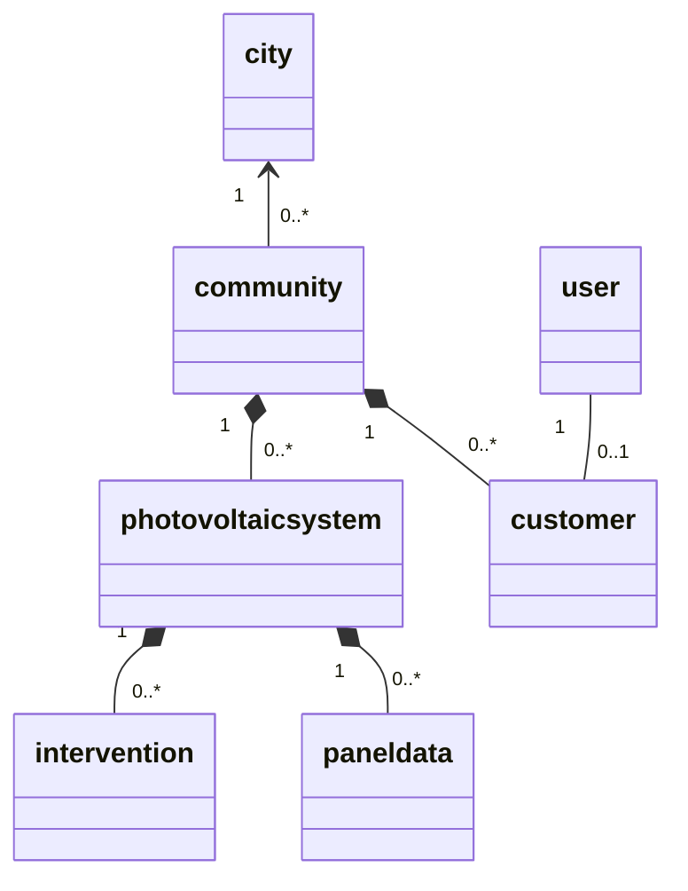

# SOLAR FAMILY

Solar Family aims to create an intelligent management system for residential photovoltaic communities.
The system optimizes self-consumption, monitors performance, and use collective intelligence to detect anomalies and improve efficiency.

## System Architecture

1. **IoT Layer (Arduino Node)**
   Each house is equipped with an Arduino-based monitoring node connected to:
   - Current Transformer sensors. One on the solar inverter output to measure production power. One on the main grid line to measure total house consumption.
   - Actuators. Smart relays to turn on/off appliances. We also have actuators that are part of an automated system for cleaning the photovoltaic panels.
2. **MQTT Communication Layer**
   MQTT acts as the messaging backbone between all the components: a Mosquitto broker routes the messages.
   The bridge of each system publishes its measurements to the topics of its system and the Django server
   subscribes to them; the server publishes the status of each system back to its bridge (see [MQTT](#mqtt)).
3. **Python Bridge**
   The bridge acts as a go-between for the microcontroller and the broker: it reads the Arduino on the serial
   port (UART), publishes the measurements and forwards the status of the system to the Arduino.
4. **Django Backend**
   The **Django server** is the intelligence center of the system.
   It exposes REST APIs to receive and serve data, stores everything in a database, and provides an **interactive web UI** for visualization.
5. **Web Dashboard (Django UI)**
   Data can be visualized through charts, tables, and alerts, giving both individual users and administrators a clear understanding of the system status.

## Key Features

1. **Self-Consumption Optimization**
   The Arduino sensors measures both house consumption and PV production in real time.
   When the surplus energy (Production - Consumption) exceeds a configurable threshold for several minutes, the server sends an MQTT command to smart relays to turn on non-essential loads, such as water heater, electric car charging and softener regeneration. This allows us to maximize the local energy use, which is more profitable than selling excess energy to the grid.

2. **Environmental Impact Calculation**
   The system converts the community's total energy production into $CO_2$ savings, showing how much pollution has been avoided thanks to renewable energy

3. **Short-Term Production Forecasting**
   Using weather forecasting APIs and the historical weather, the system estimates the energy production in $KWh$ of
   today, tomorrow and the next 7 and 30 days

4. **Dynamic Community Benchmark (Collective Intelligence)**
   Each home periodically reports its normalized yield (current power / peak installed power) via MQTT.
   The server aggregates all reports to calculate the real-time community benchmark - an objective reference for comparison.
   If a single system performs significantly below the community average, an alert is triggered (possible panel malfunction).
   If the whole community yield is inconsistent with the expected solar conditions from the weather API, the system triggers the actuators for a collective panel cleaning
5. **Energy Community Simulation**
   Each home reports its energy balance (surplus or deficit) via MQTT.
   The server computes the amount of energy that can be shared locally before importing from or exporting to the public grid, simulating the community's ability to be self-sustaining

## Implementation status

| Component / feature | Status |
|---|---|
| Sensor node (temperature, light, estimated power), water pump for cleaning the panels and Python bridge | Implemented, over MQTT (see [MQTT](#mqtt)) |
| Installation of the devices on the systems, for the technicians (and to test the bridge as any system) | Implemented (see [Devices and installations](#devices-and-installations)) |
| REST API to read the measurements (per-community read access) | Implemented |
| Home page: for visitors a showcase of the services (with the link to the city comparison); after login a dashboard with today's production of the community and the status of each system | Implemented |
| Web dashboards for communities and single systems, with the last 7 days and the weather | Implemented (see [Interface](#interface)) |
| Community totalizer on the home and energy summaries by month and year (communities and systems), with 2. CO₂ savings | Implemented (see [Energy totals and summaries](#energy-totals-and-summaries)) |
| 3. Production forecasting: today, tomorrow, next 7 and 30 days, in one page | Implemented (Random Forest, see [Forecast model](#forecast-model)) |
| 4. Community benchmark: public page with the measured yield per installed kW of every Italian city and a heatmap of Italy (measured yield, or PVGIS expected yield) | Implemented, with the automatic check of each system (see [System monitoring](#system-monitoring)) |
| ROI calculator with printable quote, for the consultants | Implemented |
| Maintenance interventions: requests of the customers, dashboard of the technicians and printable report | Implemented (see [Maintenance interventions](#maintenance-interventions)) |
| Telegram bot: alert to the owner of the community when a system has a fault and when a technician accepts a request of intervention; status of the systems, daily report of the community, last reading of a system and request of an intervention | Implemented (see [Telegram alerts](#telegram-alerts)) |
| Simulation of the systems without a sensor, run by the master of the community, with the values chosen by an administrator (for the demo with two boards) | Implemented (see [Simulated systems](#simulated-systems)) |
| Smart relays of the appliances, 1. self-consumption optimization, 5. energy community simulation | Not implemented yet |

## Project structure

```
ArduinoBridge/            Arduino sketch, SimulIDE circuit and the Python bridge (serial <-> MQTT)
  SolarNode/              Sketch: sensors, water pump and status LEDs
  TestHeltec/             Sketch: test of a Heltec WiFi LoRa 32 V3 board after soldering its pins
  MasterNode/             Sketch: master of a community (Heltec with display): Wi-Fi and installation from the phone,
                          MQTT for the LoRa nodes; ProtocolloLora.h is the LoRa protocol, copied in RoofNode/
  RoofNode/               Sketch: node on a roof (Heltec without display), the sensor of one system, LoRa only
  bridge.py               Bridge of one system: serial port (or simulated Arduino) <-> MQTT broker
  protocol.py             Serial protocol between Arduino and bridge
  serial_ports.py         Serial ports of Windows, macOS and Linux: finds the one where the Arduino answers
  simulated_node.py       Simulated Arduino, to test without SimulIDE
mosquitto/                Configuration of the MQTT broker
start.sh                  Starts docker compose passing the server the address of the PC in the local network
backend/src/
  config/                 Django settings and root URLs
  SP/                     Core app
    models.py             City, Community, Customer, PhotovoltaicSystem, PanelData, Intervention
    production.py         Minute-by-minute production series and energy (kWh)
    energy.py             Energy totals, summaries by month and year and environmental impact
    benchmark.py          Measured yield per installed kW of every city, expected yield of the reference locations
    monitoring.py         Check of each system: production compared with the forecast and with nearby systems
    interventions.py      Maintenance interventions: request, technicians' dashboard, acceptance, execution, report
    telegram.py           Telegram bot: link of the owner's account, commands and buttons, fault alerts, page Notifiche
    reports.py            Daily report of a community and last reading of a system (used by the Telegram bot)
    mqtt.py               MQTT topics and messages: readings received, status and configuration published
    mqtt_auth.py          Who can connect to the broker and to which topics (asked by the broker)
    installations.py      Installation of the devices on the systems and deletion of the systems (technicians)
    customers.py          New users waiting for a community; creation, editing and deletion of communities (technicians)
    pairing.py            Installation with the QR of the device's display: code, technician's choice, credentials
    gateways.py           Masters of the communities and their LoRa nodes: add nodes, identify, assign, remove
    simulation.py         Systems without a sensor simulated by the master, with the values chosen by an administrator
    roles.py              Roles of the staff: technicians and consultants
    access.py             Who can see which systems, pages of technicians and consultants
    static/SP/app.css     The look of the site, language "Banda verde" (see [Interface](#interface))
    templatetags/ui.py    Icons, current entry of the menu, colours of the states and other helpers of the pages
    weather.py            Daily weather from Open-Meteo (forecast and historical archive)
    api.py                REST API to read the measurements
    views.py              Home (showcase or dashboard), registration, city benchmark and production dashboards
    management/commands/  import_cities, populate_db, check_systems, mqtt_worker, telegram_bot, device_credentials
    tests/                Tests of the SP app
  forecast/               Production forecast
    predictor.py          Features, model loading, community forecast and past-year yield of a city
    reference_data.py     Reference dataset (Open-Meteo weather + PVGIS production)
    training.py           Model, validation on unseen locations and training
    views.py              Forecast page: today, tomorrow, next 7 and 30 days
    management/commands/  train_forecast_model
    data/                 Reference dataset (.csv.gz)
    ml_models/            Trained models (.joblib)
  roi/                    ROI calculator and printable quote (consultants only)
    calculator.py         Yearly cash flows, payback and ROI
  templates/              Base layout (the green band with the menu), shared partials and the icons
```

## Getting started

The backend runs in Docker (`backend/src` is mounted in the container, so code changes reload the server):

```bash
docker compose up -d --build
docker exec iot_django_server python manage.py migrate
docker exec iot_django_server python manage.py import_cities       # all the 7,894 Italian municipalities with coordinates
docker exec iot_django_server python manage.py populate_db         # realistic demo communities, users and readings
docker exec iot_django_server python manage.py createsuperuser
```

`import_cities` reads the municipalities from the ISTAT list (`backend/src/cities/Elenco-comuni-italiani.xlsx`) and
their coordinates from `backend/src/cities/coordinate-comuni.csv`, matched by ISTAT code. The coordinates come from
the [GeoNames](https://www.geonames.org/) dump of Italy (`IT.zip`, license CC-BY 4.0), where the municipalities are
the ADM3 units and their admin3 code is the ISTAT code; Castegnero Nanto, born in 2025 and not yet in GeoNames, has
the point halfway between Castegnero and Nanto. Running it again updates the existing cities and deletes none.

On macOS and Linux `./start.sh` (also `./start.sh --build`) can replace `docker compose up -d`: it also passes the
server the address of the PC in the local network, which the server in Docker cannot see. The page **Simulazione**
of the administrators shows it, to write it in the master and to open the site from the phone (see
[Simulated systems](#simulated-systems)); run the script again when the PC changes network or IP.

The web app is at http://localhost:8000. A community is a company or a family: it owns the photovoltaic systems
and its users access it with their own accounts (each user belongs to at most one community). Users register with
name, surname and, optionally, email and phone, but without a community: until a technician assigns them to one
(**Nuovi utenti**, `/sp/customers/`), their home says that the registration succeeded and that the assignment is
waiting for a technician. Only technicians and administrators create, edit and delete communities: from the page
**Community** of the menu (`/sp/communities/`, with **Nuova community**, also from **Nuovi utenti** for a waiting
user who becomes its owner; in the page of a community, **Modifica** changes name, city and owner or deletes it) or,
administrators, from the admin. A community with systems cannot be deleted from there (its readings and
interventions would go with it): its systems must be deleted or moved first; deleting it uninstalls its master.

Technicians delete a system from its installation page (**Elimina l'impianto**, `/sp/installations/<id>/delete/`),
also from the list of the systems shown when deleting its community. A confirmation page shows how many readings and
interventions go with it; its device stops working and its retained messages are cleared, and its LoRa node, if it
had one, goes back among those to assign. If a community is deleted, its users go back to waiting. Every community has one
owner, one of its users: the first user of a community becomes its owner, and another one can be chosen from the
admin; the owner can only be deleted together with the community.

`populate_db` replaces communities, users, systems and readings with demo data: by default a company in 2–3 cities
of every region (about 50), named after its owner (like "Rossi Trasporti"), with 2–4 users and 3–8 systems (the
headquarters, warehouses, offices, shops, ...), and one reading per minute for the last 7 days: about 250 systems
and 2.5 million readings, generated in about 20 seconds. The users log in as `user0`, `user1`, ...; the
consultant `consulente` and the technicians `tecnico1` and `tecnico2` (see [Users and roles](#users-and-roles)) have the same password,
`password123`. After checking the systems it turns about 70% of the probable faults into faults, as if the
washing had not helped (the demo systems have no device to wash them), creates intervention requests for most of the
faults (some already accepted) and 25 interventions executed in the last months.

The readings are realistic: every day each system produces what the forecast model predicts with the real weather
of its city (Open-Meteo), scaled by the orientation of the system (up to 7% less). About 5% of the systems have a
fault (20–50% less), and in about 15% of the cities the dust makes all the systems produce 14–22% less: the
monitoring finds them as probable faults and dirty panels. During the day the power follows the height of the sun, the clouds of that day (shared by the systems of a
city) and the cell temperature; light and air temperature follow the same sun and the day's minimum and maximum.
Options: `--days` (up to 90), `--cities_per_region`, `--users_per_community` and `--systems_per_community`
(a number or a range like `2-3`), `--seed` to generate the same data again.

The trained forecast model is in the repository. To train it again (for example after changing the features):

```bash
docker exec iot_django_server python manage.py train_forecast_model                  # uses forecast/data/reference_dataset.csv.gz
docker exec iot_django_server python manage.py train_forecast_model --refresh-data   # downloads the dataset again (a few minutes)
```

To connect a bridge, install a device on a system (page **Community** of the technicians → community → system, or
the command below, which works for any system, also those of the demo data) and start the bridge with its
credentials:

```bash
docker exec iot_django_server python manage.py device_credentials 42      # prints username (pv-42) and token
pip install -r ArduinoBridge/requirements.txt
python ArduinoBridge/bridge.py --device pv-42 --token <token>              # Arduino (SimulIDE or USB)
python ArduinoBridge/bridge.py --device pv-42 --token <token> --simulate   # simulated Arduino
```

With the Arduino the bridge finds the serial port by itself (see [Serial ports](#serial-ports) and
[Connecting the Arduino](#connecting-the-arduino)); `--serial COM2`
or `--serial /dev/cu.usbmodem1101` chooses it explicitly.

The token can also be passed with the environment variable `SOLAR_DEVICE_TOKEN`. See [MQTT](#mqtt).

## Users and roles

| Role | Who | What they can do |
|---|---|---|
| Customer | registers on the site; a technician assigns them to their community | the systems of their community: production, forecasts, intervention requests |
| Technician | group `Tecnici` | every system: installation of the devices, status, maintenance interventions; creation, editing and deletion of the communities and assignment of the new users to one; in the admin, systems, devices and interventions (communities, customers and cities only to read them) |
| Consultant | group `Consulenti` | only the ROI calculator and the quotes; after login the home is the public showcase of the services, to show it to the clients; no access to the admin |
| Administrator | superuser (`createsuperuser`) | everything, including the users |

Only the administrators create technicians and consultants: in the admin, **Utenti → Aggiungi**, choosing the
**Ruolo**. The role is the group of the user, which can be changed later in the same page; the access to the admin
(`is_staff`) follows it by itself: technicians and administrators yes, consultants no. The groups and the permissions
of the technicians are created by the migration `SP/0012_staff_roles`; the staff users existing before it get no
role until an administrator gives them one.

## Interface

The site follows one design language, "Banda verde", written in `SP/static/SP/app.css`, which is loaded after Bootstrap
and redraws its components:

- every page opens with a dark green band with rounded bottom corners: the menu, the title and the main figure of the
  page, with its chart where there is one (the day's energy and power, tomorrow's forecast, the state of the systems);
  the rest of the page sits on the light ground without cards, its groups separated by space and thin lines;
- green is the only accent colour; the states are coloured dots: OK green, dirty panels yellow, probable fault orange,
  fault red, not yet checked grey;
- the size of an element follows its importance: one large figure per page, the other values smaller, labels in
  sentence case;
- the font is Urbanist (Google Fonts); the icons are our own SVGs in `templates/partials/icons.html`, used with
  `` (`SP/templatetags/ui.py`);
- the Chart.js charts take font, colours and tooltip from `SP/static/SP/chart_theme.js`: mint on the band, green on
  the light ground. The production chart shows one point a minute ("1 min", the default), or the averages of
  15 minutes and of one hour.

## Energy totals and summaries

The home of the customers has the **totalizer** of their community: the energy generated since the first
reading, in the current year and month, the mean per day with readings, and the environmental impact of the
total. Below the list of the systems, the **energy summary** shows the energy generated day by day in a month, or
month by month in a year, with the navigation between periods; the page of each system has the same summary for
that system. Under the chart: minimum and maximum day, daily mean and total, the yield per installed kW and the
environmental impact of the period. Minimum, maximum and mean leave out the current day, which is incomplete.

The summary is loaded as JSON (`/sp/community/energy/` and `/sp/system/<id>/energy/`, parameters `period=month` or
`year` and `date=2026-10` or `2026`). The sums are made by the database (`SP/energy.py`): each reading is the mean
power of a minute, so the energy is the sum of the powers divided by 60, without interpolating the missing minutes
(the daily chart of the dashboards interpolates them). A community takes a few tens of milliseconds, all the 2.4
million demo readings about half a second.

The environmental impact uses indicative factors (constants in `SP/energy.py`): 0.25 kg of CO₂ per kWh, the order
of magnitude of the emission factor of the Italian electricity production published by ISPRA, decreasing with
the renewables; 22 kg of CO₂ absorbed in a year by a tree; 0.12 kg of CO₂ per km for an average car.

The nodes measure only the production: consumption, batteries and the energy imported from and exported to the
grid are not measured, so they are not in the totalizer and in the summaries.

## System monitoring

Every 2 days each system is checked on the last 2 complete days (`SP/monitoring.py`):

1. Its production is compared with what the forecast model predicts with the real weather of those days: if it is
   more than 10% lower, the system has an anomaly.
2. Only then it is compared with up to 10 nearby systems: those of the communities of the same city (first the ones
   of its own community) or, if there are none with readings, those of the nearest city that has some. If at least
   half of them also have an anomaly the cause is shared by the area and the panels are just **dirty**; otherwise
   the system has a **probable fault**.
3. With dirty panels the device of the system washes them. With a probable fault it washes them too, since the
   washing may be enough: after an hour of production the system is compared with the nearby systems without a
   fault in that same hour (power per installed kW, median of up to 10 systems as above). If it produces at least
   90% of them it is **OK** again; otherwise it has a **fault**. The hour must have at least 45 readings of the
   system and of the nearby systems, and these must produce at least 5% of their power: after a washing in the
   evening the comparison waits for the morning (and gives up after 2 days).

The result (`OK`, `Pannelli sporchi`, `Probabile guasto`, `Guasto`) and the date of the check are saved in the system
and shown on its page. Days with less than 90% of the readings are not compared: the system is checked again at the
next run. A fault stays a fault at the following checks until the production is normal again (for example after the
repair): it never goes back to a probable fault, which would wash the panels again.

The `scheduler` service of docker compose runs `check_systems` every hour: at each run it verifies the probable
faults washed by their device, then it checks only the systems not checked in the last 2 days, so each system is
checked every 2 days even after a restart. `populate_db` runs it at the end. To run it by hand:

```bash
docker exec iot_django_server python manage.py check_systems                   # systems due for a check
docker exec iot_django_server python manage.py check_systems --all --community 3   # every system of community 3
```

## MQTT

docker compose runs the broker (`mosquitto`, port 1883 open for the bridges on the PC) and the `mqtt-worker`
service (`python manage.py mqtt_worker`), which receives the messages of the devices and saves them. Every system
has its topics under `solarfamily/systems/<id>/`:

| Topic | From → to | Retained | Content |
|---|---|---|---|
| `telemetry` | bridge → server | no | average of one minute: `{"time_stamp": "2026-10-06T10:41:00+00:00", "temperature": 21.5, "lightness": 812.0, "power": 3.42, "samples": 40}` (power in kW, time in UTC) |
| `connection` | bridge → server | yes | `online` when the bridge connects; `offline` when it closes or, as Last Will, published by the broker when it disappears |
| `events` | bridge → server | no | water pump: `{"event": "pump_on"}`, `{"event": "pump_off"}` |
| `status` | server → bridge | yes | `{"status": "DRT", "label": "Pannelli sporchi", "previous": "OK", "changed_at": "...", "checked_at": "..."}` |
| `config` | server → bridge | yes | `{"system_id": 42, "name": "Sede", "max_power_kw": 14.62, "community": "...", "city": "...", "owner": "..."}` |

The master of a community has its topics under `solarfamily/gateways/<id of the community>/`:

| Topic | From → to | Retained | Content |
|---|---|---|---|
| `connection` | master → server | yes | `online` / `offline` (Last Will); when it goes offline its nodes are shown disconnected |
| `events` | master → server | no | `{"event": "node_joined", "node": "A3F2C1D0", "key": "...", "kind": "roof", "rssi": -52, "snr": 9.2}` (accepted only while **Aggiungi nodi** is open), `{"event": "node_left", "node": "A3F2C1D0"}` |
| `config` | server → master | yes | the nodes of the community: `{"community_id": 7, "community": "...", "nodes": [{"id": "A3F2C1D0", "key": "...", "system_id": 42, "system": "Sede"}]}` |
| `commands` | server → master | no | `{"command": "permit_join", "seconds": 180}`, `{"command": "identify", "node": "A3F2C1D0", "seconds": 10}`, `{"command": "remove", "node": "A3F2C1D0"}` |
| `simulation` | server → master | yes | the systems to simulate: `{"community_id": 7, "systems": [{"system_id": 43, "system": "Magazzino", "max_power_kw": 10.0, "power": 5.0, "temperature": 24.0, "lightness": 50000.0}]}` (see [Simulated systems](#simulated-systems)) |

All the messages use QoS 1: they are repeated until the broker confirms them, so a reading can arrive twice and
the second one is discarded (a system has one reading per minute). Status and configuration are retained: the
broker keeps the last ones and sends them to the bridge as soon as it subscribes, so the bridge knows the maximum
power of its system and its current status even after a restart. The worker publishes them again for every
installed system when it connects; `check_systems` publishes the status when it changes, the technicians' pages and the
admin when a device is installed or a system is modified.

**Access.** Nobody can connect anonymously. The broker uses the plugin
[mosquitto-go-auth](https://github.com/iegomez/mosquitto-go-auth) and asks Django (`/sp/mqtt/auth/...`) at every
connection, publication and subscription:

- the server connects as `solarfamily-server` with the password `MQTT_SERVER_PASSWORD` (`solarfamily-dev` by
  default, set another one in a `.env` file next to `docker-compose.yml`) and can access every topic;
- a device connects as `pv-<id of the system>` with its token and its username as client id. It can publish only
  `telemetry`, `connection` and `events` of its system and receive only its `status` and `config`. New
  credentials or uninstalling the device stop the old token at once.
- a master connects as `gw-<id of the community>` with its token. It can access its own topics as in the table
  above and, as a device, the topics of the systems of its nodes and of the systems it simulates. The device of a
  system whose sensor is a LoRa node (or is simulated) has no token and cannot connect.

**Bridge and Arduino.** The bridge averages the readings of the Arduino over each minute and publishes them; it
sends to the Arduino the maximum power of the system (`CFG|14620`, in W) and its status (`STATUS|DRT|1`). The
Arduino sends no reading until it has the maximum power. When the status becomes **DRT** (dirty panels) or **FLT**
(probable fault) it runs the water pump for 10 seconds, only once per change: the bridge remembers in
`ArduinoBridge/.state/` the last change it forwarded. The end of the washing (`pump_off`) starts the hour after which
the server verifies a probable fault (see [System monitoring](#system-monitoring)). The serial protocol is described in `ArduinoBridge/protocol.py`; the pins of pump and LEDs in
`ArduinoBridge/SolarNode/SolarNode.ino`.

### Serial ports

The serial link is the same on every system (UART, 9600 baud, 8N1, lines of text); only the name of the port
changes:

| | Arduino on USB | SimulIDE |
|---|---|---|
| Windows | `COM3`, `COM4`, ... (number given by Windows, see Device Manager) | virtual pair of [com0com](https://com0com.sourceforge.net/): SimulIDE on `COM1`, bridge on `COM2` |
| macOS | `/dev/cu.usbmodem…` (original boards), `/dev/cu.usbserial-…` or `/dev/cu.wchusbserial…` (clones with CH340) | virtual pair of socat (below): SimulIDE on `/tmp/solarnode-simulide`, bridge on `/tmp/solarnode-bridge` |
| Linux | `/dev/ttyACM0` (original boards), `/dev/ttyUSB0` (clones) | virtual pair of socat, as on macOS |

On macOS every port appears twice: `/dev/tty.*` waits for a carrier signal that the Arduino never sends, so the
bridge uses `/dev/cu.*`. A COM port of Windows can be opened by one program at a time; on macOS and Linux the
bridge locks the port, so that two programs do not steal each other's data.

**Identity check.** With `--serial auto` (the default) the bridge opens only the ports that can be an Arduino:
USB boards (original Arduino first) and virtual pairs. Bluetooth and system ports are never opened. It waits for
`ID|SolarNode|2` (device type and protocol version), which the sketch sends when it starts and as answer to `ID`.
Version 2 washes the panels also with a probable fault and knows the status `BRK`: a sketch with version 1 is
refused, and must be compiled and loaded again.
A USB board restarts when its port is opened, and some bootloaders (like the one of Arduino Mega) stay waiting to
be programmed if they receive data in the meantime: so the bridge first only listens, and sends `ID` (every half
second, for 3 seconds) only after a line of the sketch or after 2.5 seconds. It keeps the first port where a
SolarNode answers (without closing it, which would restart the board again) and explains why the others were
discarded: busy, silent, another device, an old sketch or another protocol version. An explicit `--serial` port is checked the
same way. To see the ports and who answers on each:

```bash
python ArduinoBridge/bridge.py --list-ports
```

### Connecting the Arduino

The Arduino of the project runs in SimulIDE; a real board on USB works the same way (see the end of each procedure).

**First, on every system**

1. Start the server: `docker compose up -d --build` (the first time also `migrate`, see [Getting started](#getting-started)).
2. Compile the sketch with Arduino IDE 2: install the library *DHT sensor library* by Adafruit (with its
   dependencies), open `ArduinoBridge/SolarNode/SolarNode.ino`, choose the board (*Arduino Uno* for SimulIDE, or
   the board you connect, like *Arduino Mega*) and use *Sketch → Export Compiled Binary*. For SimulIDE the file to
   use is `ArduinoBridge/SolarNode/build/arduino.avr.uno/SolarNode.ino.hex` (not the one `with_bootloader`); the
   `build` folder is ignored by git. A real board is programmed directly with *Upload*.
3. In SimulIDE open `ArduinoBridge/SensorsArchitecture.sim1`, right-click the Arduino → *Load firmware* → the
   `.hex` above, and save the circuit. Optionally add the pump and the status LEDs, each with a 220 Ω resistor to
   GND: pump (a LED) on D7, green on D8 (OK), yellow on D9 (dirty panels), red on D10 (blinking with a probable
   fault, on with a fault). The circuit has a thermistor on A4 while the
   sketch reads a DHT11 on D4: until they match, the temperature is always 25 °C.
4. Get the credentials of the device: page **Community** → community → system → *Installa dispositivo* (or *Nuove
   credenziali*), or `docker exec iot_django_server python manage.py device_credentials <id>`.

**Windows**

1. Install [com0com](https://sourceforge.net/projects/com0com/files/com0com/2.2.2.0/), the **signed** version
   `com0com-2.2.2.0-x64-fre-signed.zip` (64-bit Windows blocks unsigned drivers), as administrator.
2. Create the pair COM1–COM2: open *Setup for com0com* from the Start menu, rename `CNCA0` to `COM1` and `CNCB0`
   to `COM2`, *Apply* (or, in an administrator prompt in the com0com folder, `setupc change CNCA0 PortName=COM1`
   and `setupc change CNCB0 PortName=COM2`). Check them in *Device Manager → Ports (COM & LPT)*; if COM1 or COM2
   are taken, use two free numbers: SimulIDE uses the first one, the bridge finds the second by itself.
3. In SimulIDE set the *SerialPort* component to Port `COM1`, 9600 baud, 8 data bits, 1 stop bit; start the
   simulation and open the port from the component.
4. Start the bridge from the folder of the project (`py` instead of `python` if needed):

   ```powershell
   python -m venv ArduinoBridge\.venv
   ArduinoBridge\.venv\Scripts\python -m pip install -r ArduinoBridge\requirements.txt
   ArduinoBridge\.venv\Scripts\python ArduinoBridge\bridge.py --list-ports
   ArduinoBridge\.venv\Scripts\python ArduinoBridge\bridge.py --device pv-42 --token <token>
   ```

   `--list-ports` should show `COM1: occupata da un altro programma` (SimulIDE keeps it) and
   `COM2: SolarNode, protocollo 2`. The bridge then logs `Arduino SolarNode sulla porta COM2` and
   `Arduino configurato: CFG|…`, and the page of its community shows the device as connected.

With a real board: original boards install their driver by themselves, clones with the CH340 chip need the
CH341SER driver of WCH; the board appears as `COMx` in Device Manager. Upload the sketch from Arduino IDE, **close
the Serial Monitor** (it keeps the port busy) and start the bridge without `--serial`.

**macOS**

1. Install SimulIDE (*macOS X86* from [simulide.com](https://simulide.com/p/download110/)): on Apple Silicon it
   runs with Rosetta 2, which macOS offers to install. The app is not signed: open it the first time with
   right-click → *Open* (or *System Settings → Privacy & Security → Open Anyway*).
2. Install socat, which creates the virtual pair (there is no com0com on macOS), and leave it running in its own
   terminal:

   ```bash
   brew install socat
   socat -d -d pty,raw,echo=0,link=/tmp/solarnode-simulide pty,raw,echo=0,link=/tmp/solarnode-bridge
   ```

3. In SimulIDE set the *SerialPort* component to Port `/tmp/solarnode-simulide` (the whole path), 9600 baud; start
   the simulation and open the port.
4. Start the bridge in another terminal:

   ```bash
   python3 -m venv ArduinoBridge/.venv
   ArduinoBridge/.venv/bin/pip install -r ArduinoBridge/requirements.txt
   ArduinoBridge/.venv/bin/python ArduinoBridge/bridge.py --list-ports
   ArduinoBridge/.venv/bin/python ArduinoBridge/bridge.py --device pv-42 --token <token>
   ```

   `--list-ports` should show `/tmp/solarnode-bridge (porta virtuale…): SolarNode, protocollo 2`; the Bluetooth
   ports are not queried.
5. Start them in this order: socat, SimulIDE, bridge. Restarting socat changes the virtual ports, so the port must
   be opened again in SimulIDE. The bridge can be closed and started again; if socat closes together with it,
   start socat again and reopen the port in SimulIDE.

With a real board: usually no driver is needed; an original board appears as `/dev/cu.usbmodem…`, a CH340 clone
as `/dev/cu.usbserial-…` (the same ports also appear as `/dev/tty.*`: the bridge uses `cu`). Upload the sketch,
**close the Serial Monitor** and start the bridge without `--serial`.

**If something goes wrong**, `--list-ports` tells what it finds on each port:

| Message | What to do |
|---|---|
| no port that can be an Arduino | Windows: com0com is not installed or not recognized, try `--serial COM2`; macOS: socat is not running |
| nessuna risposta | the simulation is not running, the port is not open in SimulIDE or SimulIDE uses another port; with a USB board, upload the sketch again and close the Serial Monitor |
| non è un SolarNode aggiornato | SimulIDE still has the old `.hex`: load `SolarNode.ino.hex` |
| protocollo 1, mentre il bridge usa il 2 | the sketch is older than the bridge: compile it again and load the new `.hex` (or upload it to the board) |
| occupata da un altro programma | another bridge or the Serial Monitor is open (on Windows it is normal for COM1, kept by SimulIDE) |

### Testing a Heltec board

The LoRa nodes are two Heltec WiFi LoRa 32 V3 boards. `ArduinoBridge/TestHeltec/TestHeltec.ino` tests a board
after soldering its pins: microcontroller, flash, display, LED, battery, Wi-Fi, LoRa radio and the soldered free
pins (GPIO 2–7, 19, 38–42, 45, 46).

1. In Arduino IDE 2 install the *esp32* boards by Espressif and the libraries *RadioLib* (8.0 or later) and *U8g2*,
   choose the board *Heltec WiFi LoRa 32(V3)* and upload the sketch to both boards. Screw the LoRa antenna on before
   powering a board: transmitting without it can damage the radio.
2. Open the Serial Monitor at 115200 baud and press RST: every check prints `[OK]`, `[ERRORE]`, `[ATTENZIONE]` or
   `[VEDI]` (to check by eye), and any short between two pins or towards GND or 3V3 is named.
3. Touch each free pin with a jumper wire from GND or 3V3 (never 5V): the page *Saldature* of the display (button
   PRG) marks it `G` or `3` as soon as the microcontroller feels the contact, so the joint conducts.
4. With both boards on, the page *LoRa* shows the pings of the other board (one every 10–12 s) with RSSI and SNR.

## Devices and installations

The page **Community** of the technicians (`/sp/communities/`) lists the communities with owner, users, master,
nodes and systems (how many with the sensor connected, disconnected or without sensor); the search finds a community
also by the name of one of its systems. The page of a community (`/sp/communities/<id>/`) has its master, its LoRa
nodes and its systems with the state of their sensor; each system opens its installation page
(`/sp/installations/<id>/`: device, last message, last cleaning). From there the technicians can:

- **create a new system** of a community with its device (**Nuova installazione**, from the page of the community
  it is already chosen), as a technician installing it would do;
- **install a device** on an existing system (for example to test the bridge as a system of the demo data),
  **generate new credentials** (the old token stops working) or **uninstall** it;
- **set the status** of the system, saved as if the automatic check had found it and sent to the device: with
  *Pannelli sporchi* or *Probabile guasto* the Arduino runs the pump (with *Probabile guasto*, an hour of production
  later the server verifies whether the washing helped). Every status set is a new change, so the cleaning can be
  tested again.

The token is shown once, with the command to start the bridge; only its hash is saved. `populate_db` deletes the
systems and so their devices.

### Installing a device with the QR of its display

A device with a display (the Heltec boards) is installed without copying username and token:

1. connected to the Wi-Fi, the device asks the server for a code (`POST /sp/devices/pairing/`) and shows on its
   display the QR of the pairing page (`/sp/pair/<code>/`) with the code, as `ET2J-UZDR`;
2. the technician scans the QR with the phone (logging in if needed) and chooses the system: one without a device
   (the most recent are listed first), one found by name or community, or a new one. Without a camera, the code can
   be written in the box **Installa con il QR del display** of the page of the system;
3. the device asks every 5 seconds whether it was paired (`POST /sp/devices/pairing/credentials/` with the code and
   a secret received with it) and, once the technician has chosen, receives username, token and the address of the
   broker. It saves them in its flash and connects as the bridge does.

The master of a community asks for its code with `role=gateway`: the pairing page then lists the communities
instead of the systems, and the master receives the credentials `gw-<id of the community>` (see below).

The page of the system follows the installation and refreshes by itself: *in attesa del dispositivo* until the
device takes its credentials, then *credenziali consegnate* until it connects to the broker.

- A code lasts 10 minutes, installs one device and gives the credentials once; after the choice the device has 2
  minutes to take them, otherwise the code expires and the display shows a new QR.
- The code is visible to anyone who looks at the display, but only the device knows the secret needed to take the
  credentials (the server saves its hash). The token is generated when the device takes it, so it is never saved.
- Choosing a system that already has a device gives new credentials, as **Nuove credenziali**: the old device
  stops working. Only the last device chosen for a system receives the credentials.
- The broker address sent to the device is the host the device used to reach the server (with docker compose,
  broker and server are on the same PC), port 1883. Set `MQTT_PUBLIC_HOST` and `MQTT_PUBLIC_PORT` to change it.

### Community master and LoRa nodes

In a community only one device is connected to the internet: the **master** (`ArduinoBridge/MasterNode`, a Heltec
board with display), installed on the community with its QR. Every other board is a **node on a roof**
(`ArduinoBridge/RoofNode`, without display), the sensor of exactly one system: it talks only to the master, over
LoRa, and the master publishes for it on the broker.

The nodes join the network of the master as Zigbee devices join the one of their hub:

1. in the page of the community (**Community** → community) the technician presses **Aggiungi nodi**: for 3
   minutes the master accepts the new nodes it hears (*permit join*); its display shows the countdown;
2. a node that never joined asks to enter every 15 seconds (LED: one flash per second). The master and the node agree
   on an AES-128 key with X25519 (ECDH): only the public keys go over the radio, so whoever listens cannot compute
   it. The master tells the server, and the node appears under **Da assegnare** (LED: two flashes every 3 seconds);
3. **Identifica** makes the LED of the node blink fast for 10 seconds, to know which roof it is on; then the
   technician chooses its system among those of the community of the master. The system gets a device without a
   token (it never connects to the broker itself): the master publishes `online` on its `connection` topic at
   every beat of the node and forwards it the status of the system (LED: one flash at every answer of the master).

After joining every packet is encrypted and authenticated with AES-128-CCM and carries a counter, so a recorded
packet sent again is discarded. The server keeps the keys of the nodes and sends them to the master (retained
`config`): a new master installed on the community talks to the nodes without pairing them again. The protocol is
described at the top of `ProtocolloLora.h`, the same file in both sketches (a test checks the two copies).

- **Rimuovi** (trash icon) makes the node leave the network: it goes back to new. The same happens holding PRG on
  the node for 10 seconds (the LED stays on when it is enough).
- A node that joins again, even after a reset, is a new node and must be assigned again.
- A system has one sensor: assigning another node, or installing a bridge with **Nuove credenziali**, replaces it.
- If the master goes offline, its nodes are shown disconnected too.

**Trying it with the two Heltec boards.** Screw the LoRa antennas on before powering the boards. In Arduino IDE 2
install the libraries *U8g2*, *RadioLib* (8 or later), *PubSubClient* (Nick O'Leary) and *ArduinoJson* (Benoit
Blanchon, 7 or later); Wi-Fi, web page, DNS, QR and cryptography come with the *esp32* package (3.x). Choose the
board *Heltec WiFi LoRa 32(V3)*. Nothing is written in the sketches.

1. **Master: Wi-Fi.** Upload `MasterNode` to the first board. It creates its own network, `Solar-XXXX` with a random
   password, and the display shows its QR (name and password are written next to it). Frame it with the phone's
   camera: the phone joins the network and opens the board's page by itself, as the Wi-Fi of a hotel (otherwise open
   `http://192.168.4.1`). Choose the network (2.4 GHz only) and write its password. Under *Avanzate* write the
   address of the PC that runs docker compose in the local network, for example `http://192.168.1.10:8000`: started
   with `./start.sh`, the page **Simulazione** shows it (otherwise `ipconfig getifaddr en0` on macOS, `ipconfig` on
   Windows); not `localhost` or `0.0.0.0`. The board tries the
   network while keeping its own on, says on the page whether it works and only then saves it.
2. **Master: installation.** The display shows the pairing QR: connect the phone to the same network as the PC,
   scan it, log in as a technician and choose the community. The page of the community shows the master *Collegato*.
3. **Node.** Upload `RoofNode` to the second board (its display stays off): the LED flashes once per second. In the
   page of the community press **Aggiungi nodi**: within 15 seconds the node appears under *Da assegnare*. Press
   **Identifica** to see its LED blink, then assign it to a system: within a minute the page shows it *Sentito dal
   master*, and the page of the system shows *Collegato*.
4. **Starting again.** On the master hold PRG: from 3 seconds its display says what happens when it is released
   (after 3 seconds a new installation, after 10 seconds the Wi-Fi too; the server address is kept). On the node
   hold PRG for 10 seconds, or remove it from the site. RST only restarts a board, which keeps everything.

The serial monitor (115200 baud) of both boards shows every step. If the saved network of the master does not
answer for 2 minutes, its Wi-Fi configuration opens by itself without forgetting the network. If the master cannot
reach the server, check that the address answers from the phone's browser too and that the firewall of the PC lets
in connections on ports 8000 and 1883.

To test the bridge without a broker or serial port:

```bash
cd ArduinoBridge && python -m unittest discover -s tests -t .
```

### Simulated systems

With two boards a community has one system with a real sensor; the **master** can simulate the others, so that its
display shows the whole community. Only the administrators (superusers) have the page **Simulazione** of the menu
(`/sp/simulation/`): it lists the communities with a master, and the page of a community (`/sp/simulation/<id>/`):

1. **Avvia la simulazione** gives every system of the community without a device a simulated sensor
   (`SimulatedSensor`) and a device without a token, as for a LoRa node. The systems with a real sensor (bridge or
   LoRa node) are not touched. Systems added later are simulated with **Simula anche N nuovi impianti**.
2. The server sends the list of the simulated systems, with the values of their sensors, to the master (topic
   `simulation`, retained, see [MQTT](#mqtt)). The master treats each one as a roof node without radio: a page of its
   display (button PRG, with *Sensore simulato dal sito*), and it publishes for it the connection, a reading every 10
   seconds averaged over the minute (`telemetry`) and the washing (`events`) when the status becomes DRT or FLT. The
   server saves and checks them like the other systems: dashboards, totals, Telegram reports and **Imposta stato**
   of the installation page work as for a real sensor.
3. For each simulated system the page has production (kW, from 0 to the installed power), temperature (°C, from -30
   to 60) and light (lux, from 0 to 100,000), with a slider and a box. Every change is sent at once, without
   reloading the page: the master receives it and shows it on its display within a second. The scenarios *Sole
   pieno*, *Sole velato*, *Nuvoloso* and *Notte* fill the three values of a system, or of all of them. Every 5
   seconds the page shows whether the master hears each system, its status and the last reading saved by the server.
4. **Ferma la simulazione** removes the simulated sensors and their devices: the systems go back without a sensor
   and the master stops showing them. A simulated system that gets a real sensor (credentials of a bridge, QR of a
   display or a LoRa node) stops being simulated, and uninstalling the master stops the whole simulation.

**Address of the server.** At the top of the page there is the address at which the master and the phone reach the
server in the local network (like `http://192.168.1.62:8000`): the one to write under *Avanzate* in the Wi-Fi
configuration of the master, and the address of the pairing QRs. The server runs in Docker and cannot see the
network of the PC, so:

- opened with an address of the local network (for example from the phone), the page shows that one;
- otherwise it shows the one passed by `./start.sh` when it started docker compose (`SERVER_LAN_HOST`), after
  checking that the site still answers there: if the PC changed network or got a new IP from the router, the page
  says *Non risponde* and `./start.sh` must be run again (it recreates only the container of the server);
- without the script the address is unknown (on Windows: `$env:SERVER_LAN_HOST="192.168.1.62"; docker compose up -d`
  in PowerShell, with the address shown by `ipconfig`).

**Demo with the two Heltec boards.** After installing the master and assigning the roof node to one system (see
above), log in as an administrator, open **Simulazione** → the community → **Avvia la simulazione**. The display of
the master adds one page per simulated system and their production to the total of the community; move the sliders
and the display follows. The master must run the sketch of this version: the previous one simulated three fixed
virtual nodes that joined with **Aggiungi nodi**; if some are left in the page of the community, remove them.

## Maintenance interventions

When the check finds a probable fault or a fault (confirmed after the washing), the page of the system shows the
**Richiedi intervento** button to the users of its community: it opens a calendar to choose the day of the intervention (from tomorrow to two months ahead).
The owner of the community can also request it from the Telegram bot (`/intervento`, see [Telegram alerts](#telegram-alerts)). A
system can have one open request at a time; after an intervention a new one can be requested only if a later check
finds the fault again. The users see the status of the requests on the page of the system:

1. **Richiesta inoltrata**: the request waits for the technicians;
2. **Richiesta accettata**: a technician chose the kind of intervention and accepted the request, taking charge of
   it. Only that technician can record the execution. The owner of the community gets a message on Telegram (see
   [Telegram alerts](#telegram-alerts));
3. **Intervento eseguito**: the date of execution, the work done and the cost are recorded.

The dashboard of the technicians (`/sp/interventions/`, menu **Interventi**, with the number of requests to accept) shows the
requests to accept, the interventions in progress and the executed ones, with the requests whose day has passed.
Every intervention has a printable report (or saved as PDF from the browser), available to the technicians and to the
users of the community.

## Telegram alerts

The owner of a community can get an alert on Telegram when a system has a **fault**, that is when the washing
did not help and the system still produces less than the nearby systems (`Guasto`, see
[System monitoring](#system-monitoring)). The alert goes only to the owner, once, when the status becomes a fault:
not at the following checks, and not for a probable fault, which the washing may solve in an hour. It has a link to
the page of the system, where the owner can ask for an intervention. A fault set by hand sends the alert too: in the
admin when the status changes to `Guasto`, and every time with **Imposta stato** of the page of the installation.

The owner also gets a message when a technician **accepts a request of intervention** of the community (also
one made on the site by another user): who took charge of it, the requested day, the kind of intervention and the
link to the page of the system. It is sent once, when the request goes from `Richiesta inoltrata` to `Richiesta
accettata`, from the page of the intervention or from the admin; not when the intervention is executed.

**Linking the account.** Only the owner has the box **Notifiche Telegram** in the profile (the username in the menu,
`/sp/profile/`), which shows whether the account is linked and opens the page **Notifiche Telegram**
(`/sp/community/telegram/`). Its button **Collega Telegram** opens the bot with a code of that owner
(`https://t.me/<bot>?start=<code>`); when the owner presses **Avvia**, Telegram sends `/start <code>` to the bot and
the server saves the chat of the owner. A bot cannot write first to a user, so this step is needed. The code works
once. **Scollega Telegram** on the same page, the command `/stop` or blocking the bot unlinks the account. A Telegram
account receives the alerts of one owner.

**Commands** of the bot (also in the menu of the chat):

| Command | Answer |
|---|---|
| `/stato` | Status of every system of the community, with the date of the last check |
| `/report` | Report of today until now; `/report ieri`, `/report 15/11` or `/report 15/11/2026` for another day |
| `/lettura` | Last reading of a system, chosen with the buttons |
| `/intervento` | Request of an intervention for a system with a fault, and the open requests |
| `/stop` | Unlinks the account: no more alerts |
| `/aiuto` | The list of the commands |

The **daily report** (`SP/reports.py`) has the energy of the community with the change from the day before (for
today, from yesterday until the same time), the yield per installed kW, the peak of the community (the minute in
which its systems produced the most together), the minimum and maximum temperature and the CO₂ saved; then, for
each system, energy, yield and peak. The status of a system is shown only if it is not OK, since it is the status
of now, not of that day. As in the [energy summaries](#energy-totals-and-summaries) the sums are made by the
database, without interpolating the missing minutes: if less than 95% of the minutes have a reading, the report
says so. The buttons under it show the day before and the day after.

The **last reading** shows when it arrived (with a warning if it is older than 10 minutes), the power (also as a
share of the installed power), temperature, light, the energy produced today, the status of the system and, if it
has a device, whether the device is connected. With more than one system, `/lettura` first asks which one with a
button per system; under the reading the same buttons show another system, or refresh the one shown (🔄).

The **request of an intervention** follows the rules of the page of the site (see
[Maintenance interventions](#maintenance-interventions)), with the same code and the same form
(`request_unavailable` and `InterventionRequestForm` in `SP/forms.py`): only for a system with a probable fault or a fault
not yet handled by an intervention, for a day from tomorrow to 60 days ahead, with optional notes for the
technician. `/intervento` shows a button for each system that can have one (with only one, it goes straight to
the day) and the open requests of the community. The day is chosen with a button, one week at a time. Then the
owner either writes a note, which is sent with the request, or presses **Invia senza note**; **Annulla** or any
command cancels the request. While the bot waits for the note (at most 30 minutes) it keeps system and day in the
Django cache. The rules are checked again at each step, also for the buttons of old messages. The request is
then handled by the technicians as one made from the site.

A button pressed in the chat reaches the bot as a `callback_query` with its data (`report:2026-11-16`,
`lettura:42`): the bot confirms it (`answerCallbackQuery`) and replaces the message with the new one
(`editMessageText`), so the chat does not fill up with reports. The bot checks again that the system is of the
owner's community, also for the buttons of old messages.

**How it works.** The server talks to Telegram only with HTTPS requests to the
[Bot API](https://core.telegram.org/bots/api) (`SP/telegram.py`, with `requests`):

- `check_systems` (service `scheduler`), the admin, the page of the installation and the page of the intervention
  send the alerts with `sendMessage`, after saving the new status. If Telegram does not answer, the alert is lost
  but the status is saved: the fault or the accepted request is still on the site.
- The service `telegram-bot` runs `python manage.py telegram_bot`, a process that runs forever like `mqtt-worker`.
  It reads the messages sent to the bot with **long polling**: `getUpdates` keeps the request open up to 50 s,
  until a message arrives, then the bot answers and asks again. Each request confirms the messages already read.
  The messages sent while the service is stopped stay on Telegram for 24 hours and are answered when it starts
  again. No open port or public address is needed (a webhook would need one). If Telegram is not reachable, the
  service retries every 30 s. Like `mqtt-worker`, it is a long process: after changing `SP/telegram.py` or
  `SP/reports.py` it must be restarted with `docker compose restart telegram-bot`.

**Configuration.** Create the bot with [@BotFather](https://t.me/BotFather) (`/newbot`) and put its token and
username in a `.env` file next to `docker-compose.yml` (it is not on git: the token gives full control of the bot):

```bash
TELEGRAM_BOT_TOKEN=123456789:AAH...
TELEGRAM_BOT_USERNAME=SolarFamilyBot
SITE_URL=http://localhost:8000      # optional, address of the site in the links of the messages
```

Then `docker compose up -d` recreates the services with the new variables. Without a token the alerts are off,
the page says so and the `telegram-bot` service just waits. Only one process at a time can read the messages of a
bot: if two people run docker compose with the same token, Telegram answers `Conflict` to one of them. Each one
should create a bot for development.

**Trying it.** With the demo data, log in as `user0` (owner of the first community), open the profile from the
username in the menu and link your account with **Collega Telegram**, then send `/stato` to the bot. To get an alert
without waiting for a real fault, log in as `tecnico1`, open **Community**, choose that community and one of its
systems and set its status to `Guasto` with **Imposta stato**. The messages and errors of the bot are in its log:

```bash
docker logs -f iot_telegram_bot
```

## Tests

```bash
docker exec iot_django_server python manage.py test
```

The tests use a separate database and do not call Open-Meteo or Telegram.

## Forecast model

The model predicts the daily energy produced per installed kW (kWh/kWp) from the weather of the day and the
position of the sun (latitude and solar declination). Multiplied by the installed power it gives the production of
a system or of a whole community; summed over the real weather of the last 365 days it gives the annual production
used by the ROI calculator.

- **Algorithm**: Random Forest (scikit-learn), 100 trees with at least 50 days per leaf.
- **Training data**: 24 locations from Aosta to Catania, 2021–2023 (26,280 days). Features: daily weather from the
  Open-Meteo historical archive. Target: production of a 1 kWp system computed by
  [PVGIS](https://joint-research-centre.ec.europa.eu/photovoltaic-geographical-information-system-pvgis_en)
  (European Commission, JRC) from satellite irradiance, for an optimally oriented system with 14% system losses.
- **Validation** on locations excluded from training: mean daily error 0.48 kWh/kWp, annual production error 2.1%
  on average (7.8% at most).

**Forecast page** (`/forecast/`, menu **Previsioni** of the customers): the production of the community today,
tomorrow and in the next 7 and 30 days, with a chart day by day and the weather of the next 7 days.

- Open-Meteo forecasts the weather up to 15 days after today: the first 16 days use the weather forecast, with one
  request for all of them (kept in cache for an hour, as Open-Meteo updates its forecasts every hour).
- The following days (from the 17th to the 30th) are estimated from the history: the average of the yield that the
  model predicts with the real weather of the last 5 years, in the days at most 3 days away from the same day of
  the year (35 days). One day per year would give an average that changes at random from one day to the next. The
  chart shows them with lighter bars, with the minimum and maximum of those days. The 5 years of weather are one
  request to the Open-Meteo archive (about 1 s), kept in cache for a day.

The previous model was trained on the fictitious data of `populate_db`, whose production does not depend on the
weather: it predicted 5.76 kWh/kWp every day of the year in every city (about 2,100 kWh/kWp per year, 33–55% more
than PVGIS, with no seasons). The measurements of the communities can be added to the training once they cover at
least a full year.

# Possibili implementazioni

## 4. **Dynamic Community Benchmark (Collective Intelligence)**

### Su Arduino (per ogni casa)

- **Misurazione:** Leggere la potenza istantanea ($W$) prodotta.
- **Invio Dati (MQTT Publish):** Pubblicare su un topic MQTT (es. `comunita/casa_A/produzione`) un payload JSON : `{ "potenza_w": 1500}`.
- **Ricezione Alert (MQTT Subscribe):** Sottoscriversi a un topic di alert (es. `comunita/casa_A/alert`) per ricevere messaggi dal server (es. "Pulisci pannelli").

### Su Python Bridge (MQTT <-> HTTP)

- **Ascolto (Subscribe):** Sottoscriversi al topic "wildcard" di produzione: `comunita/+/produzione`.
- **Inoltro (HTTP POST):** Quando riceve un messaggio, estrarre l'ID della casa (es. `casa_A`) dal topic e inoltrare il payload JSON all'endpoint API di Django (es. `POST /api/produzione/`).

### Su Server Django (Backend)

- **Modelli (Database):**
  - `Impianto`: Per salvare i dati statici (es. `nome="casa_A"`, `potenza_picco_wp=3000`).
  - `DatoProduzione`: Per salvare i dati in ingresso (Timestamp, `potenza_w`, `impianto [FK]`).
- **API (Ricezione):** Creare l'endpoint `POST /api/produzione/` che riceve i dati dal Bridge e li salva nel database.
- **Logica di Business (Task periodica, es. ogni 5 min):**
  1. Recuperare gli ultimi dati validi (es. ultimo minuto) di _tutti_ gli impianti.
  2. Calcolare il rendimento (`potenza_w / potenza_picco_wp`)di ogni casa
  3. Calcolare il \*\*`rendimento_medio_comunita
  4. Ciclare su ogni impianto: se `rendimento_singolo < (rendimento_medio_comunita * 0.85)` (cioè performa il 15% in meno della media), marcare l'impianto come "anomalo".
  5. **Azione:** Se un impianto è "anomalo", pubblicare un messaggio sul suo topic MQTT (es. `comunita/casa_A/alert` con payload `"performance_bassa"`) e salvarlo nel DB.
- **API (Esposizione):** Creare un endpoint `GET /api/dashboard/` che mostri lo stato di ogni impianto e il benchmark della comunità.

## 5. Simulazione di una Comunità Energetica

### Su Arduino (per ogni casa)

- **Misurazione:** Leggere la potenza istantanea prodotta e i consumi totali della casa
- **Invio Dati (MQTT Publish):** Modificare il payload MQTT (es. sul topic `comunita/casa_A/bilancio`) per includere i consumi: `{ "produzione_w": 1500, "consumo_w": 400 }`.

### Su Python Bridge

- **Ascolto (Subscribe):** Sottoscriversi al nuovo topic `comunita/+/bilancio`.
- **Inoltro (HTTP POST):** Inoltrare il nuovo payload (produzione + consumo) a un endpoint API dedicato (es. `POST /api/bilancio/`).

### Su Server Django

- **Modelli (Database):** Aggiornare il modello `DatoProduzione` per includere il campo `consumo_w`.
- **API (Ricezione):** Creare l'endpoint `POST /api/bilancio/` per salvare i dati.
- **Logica di Business (Endpoint di calcolo):** Creare un endpoint `GET /api/comunita/stato/` che, quando chiamato:
  1. Recupera gli ultimi dati di bilancio di tutte le case.
  2. Calcola il `bilancio_casa` per ognuna (es. `produzione - consumo`).
  3. Calcola il `bilancio_totale_comunità` (somma di tutti i bilanci).
  4. **Logica di Simulazione:** Calcola quanta energia è "autoconsumata" dalla comunità (l'energia prodotta dai surplus che copre i deficit) e quanta è prelevata dalla rete esterna.
- **Dashboard:** Creare una pagina web che chiami questa API e mostri graficamente i flussi energetici (es. Casa A dà 500W a Casa C; la comunità preleva 1200W dalla rete).

# Diagramma ER


